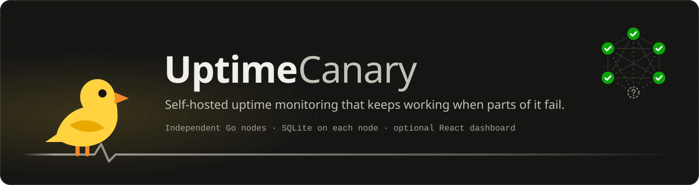
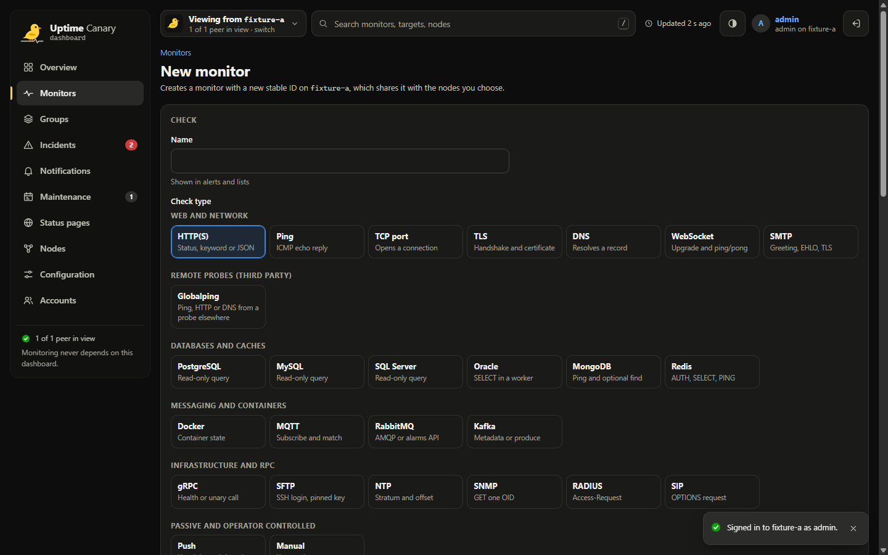
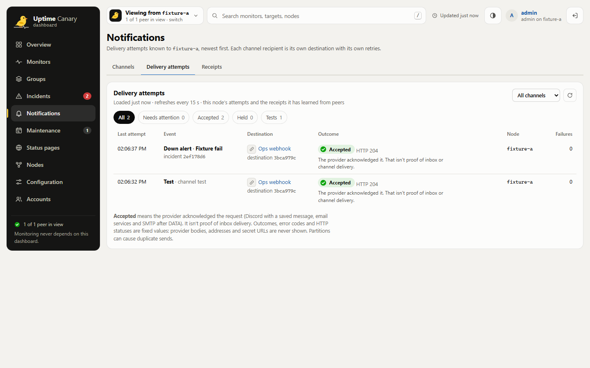
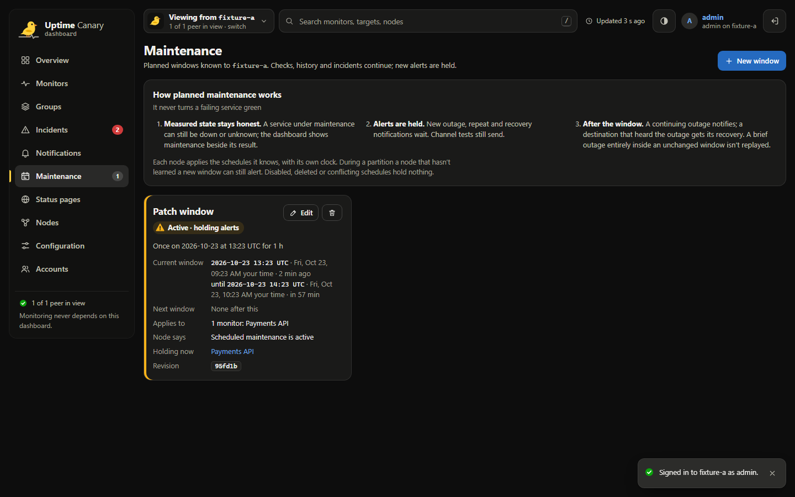
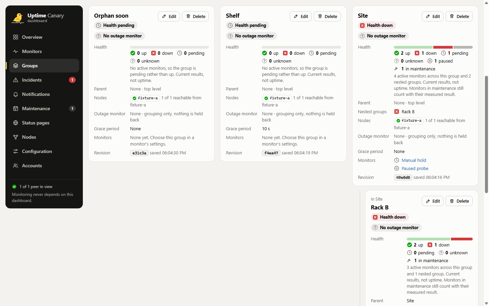
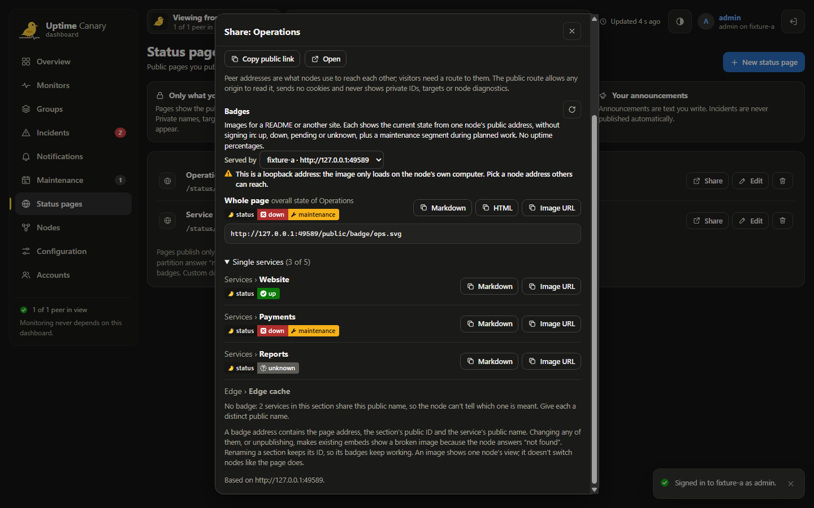
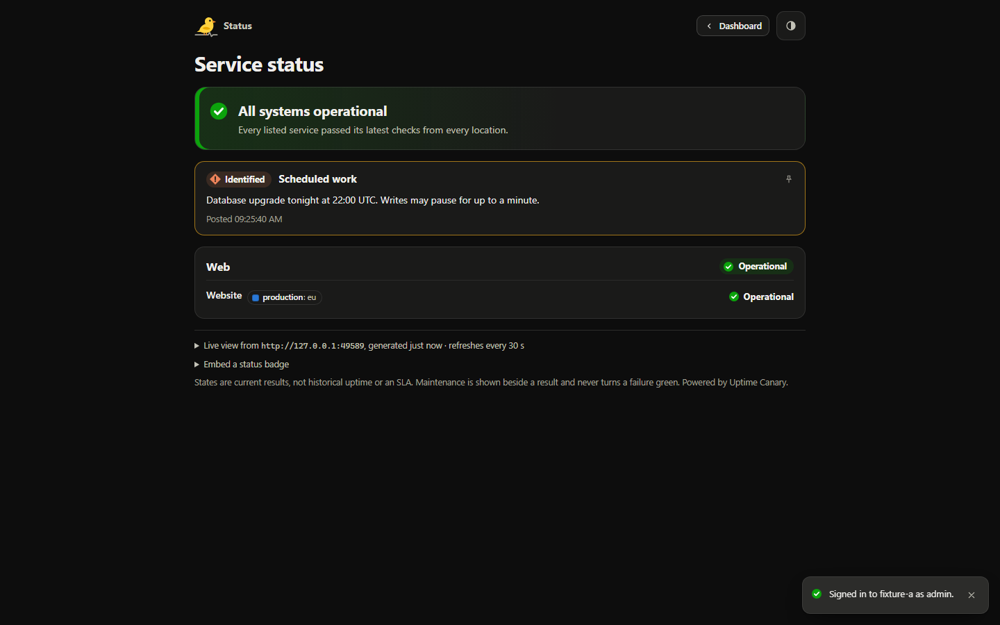
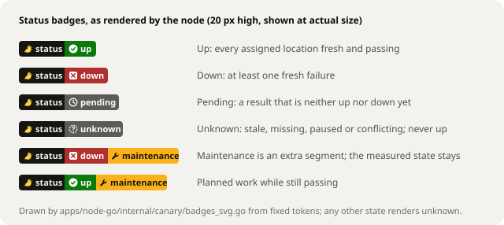

<h1 align="center"></h1>

<p align="center"><b>Self-hosted uptime monitoring that keeps working when parts of it fail.</b></p>

Uptime-Canary runs as a small group of independent, headless Go nodes. Each node runs your checks, keeps its own history in SQLite, opens incidents and sends alerts. Nodes that can reach each other coordinate, so you normally get one alert per outage and destination instead of one per node. Nothing central has to stay up: there is no shared database, no quorum and no required dashboard. An optional React dashboard and public status pages read from any node you choose.

> [!IMPORTANT]
> **Published development builds: 32 monitor types, peer protocol 19.**
> [PR #12](https://github.com/Narehood/Uptime-Canary/pull/12) merged as
> [`34442cc`](https://github.com/Narehood/Uptime-Canary/commit/34442cc040f2b00f17ba45b3a6bfb338d0552b14)
> on 2026-10-25 after its native, container, race, upgrade and image-build gates
> passed. Matching node, dashboard and optional GameDig images are published on
> GHCR for **Linux amd64**. Upgrade peers together; protocol 18 and 19 cannot sync.
> These are development builds, with no tagged release or completed release
> certification. [Validation and review limits](#checks-and-validation),
> [remaining work](#not-yet-implemented), [historical results](docs/validation-history.md).


[What it does](#what-it-does) · [How it works](#how-it-works) · [Quickstart](#quickstart) · [Dashboard](#the-dashboard) · [Checks](#check-types) · [Alerts](#alerts-and-channels) · [Groups](#one-alert-for-a-shared-outage) · [Status pages](#status-pages) · [Several nodes](#run-several-nodes) · [When things fail](#when-things-fail) · [Headless](#manage-it-headless) · [Validation](#checks-and-validation) · [Not yet](#not-yet-implemented)

**Protocol-20 candidate:** native node TLS with retained ten-year certificates,
verified fingerprint trust, alert message presets with Discord card previews,
and centrally cached container update notices. This branch is still undergoing
validation; these changes are not a published release. See
[encrypted connections](docs/transport-tls.md), [message presets](docs/notifications.md#message-presets-and-previews-protocol-20)
and [software updates](docs/software-updates.md). Upgrade every peer together.

## What it does

| Area | What you get | Scope |
| --- | --- | --- |
| Checks | **32** monitor types with structured forms, placement, retries, inversion, maintenance, tags and channels | [Types and prerequisites](#check-types) |
| Web and network | HTTP status/content/JSON/JSONata, Basic/Bearer/OAuth2, DNS SRV/SOA/CAA, WebSocket OAuth2/subprotocols, optional TCP TLS | [Engine contracts](apps/node-go/internal/checks/README.md) |
| Databases and services | SQL, caches, queues, containers, RPC and infrastructure checks | [Service options](apps/node-go/internal/services/README.md) |
| Host-local checks | System service, PM2 process and Tailscale ping | Read-only; installed service/client and platform prerequisites apply |
| Browser checks | Remote Chromium page loads with fresh private contexts and optional private screenshots | Dedicated external browser; no browser included in node/dashboard images |
| Game servers | Steam directory membership and GameDig queries through an optional private service | 358 GameDig catalogue IDs, not 358 verified protocols |
| Editing | Descriptions, cloning, preserved unknown fields, default channels, bulk channel assignment and unsaved channel tests | Private settings stay masked; clones include secrets and get a new push token |
| Alerts | Discord, SMTP, Mailgun, Brevo, Mailchimp Transactional, webhooks, Slack, Telegram, ntfy, Gotify and Pushover | Per-destination acceptance, retries and durable receipts; acceptance is not inbox delivery |
| High availability | Independent nodes coordinate alerts and reconcile after partitions | Duplicates remain possible; no quorum or shared database |
| Groups | Nested health views and destination-specific outage dependencies | Parent health does not inherit holds or maintenance |
| Maintenance and tags | Six time-zone-aware schedules; reusable colored tags and opt-in public labels | Checks continue during maintenance |
| Public status and badges | Typed presentation, safe Markdown, announcement RSS, current-state badges and optional 24 h observed history | Explicit publication; no credentials or private monitor names |
| Local history | Sample history, observed-state durations, known-time availability, coverage and latency statistics | One node's observations; gaps stay unknown; not an SLA |
| Accounts | Passwords, TOTP, revocable sessions and admin/editor/viewer roles | Node accounts remain local; dashboard accounts share one registered-node list |
| Dashboard registry | Automatic bundled node, verified enrollment, rename/address changes, role-credential rotation and recovery | Connections originate at the dashboard server (node-initiated connections are a [candidate](#add-nodes-from-the-dashboard)); no dashboard HA |
| Operations | CLI, Prometheus metrics, live SQLite backup, quarantined restore preparation and explicit activation | Retained identity is required; follow the [backup contract](docs/backups.md) |
| Encrypted transport (protocol 20) | Native TLS 1.3, retained ten-year self-signed certificates, explicit certificate pins and offline renewal | New direct-node wizard defaults to HTTPS; existing HTTP deployments require an explicit migration |
| Update notices (protocol 20) | One dashboard-owned check every six hours, cached results and an admin Check now action | Official node/dashboard image metadata only; nothing installs automatically |

## How it works

![Historical architecture illustration: three of about six independent headless Go nodes. Each runs 28 check types (push included), alerts, maintenance and groups, a management API, and its own SQLite database, and reaches monitored services and alert destinations (Discord, SMTP, Mailgun, Brevo, Mailchimp, webhooks) directly. Nodes sync configuration revisions, latest observations, incidents, receipts and heartbeats with every listed peer. Raw history and accounts stay on each node. Operators use the CLI or the optional dashboard, one node at a time.](docs/assets/architecture.svg)

*Historical illustration, not redrawn: it shows an earlier scope, with 28 check types per node, the alert providers of that time and a static dashboard that signs in to one node at a time directly. It doesn't show the current [check types](#check-types) (32 monitor types), the chat and push channels or the dashboard server with its shared node list ([deployment options](#deployment-options)), which the points below describe.*

- **Every node is complete on its own.** One Go executable with its own checks, incidents, alerts, management API and SQLite file. It keeps working when its peers or the dashboard are gone.
- **Peers share current state, not history.** Configuration revisions and tombstones (monitors, groups, channels, maintenance, status pages, tags), latest observations, incidents, receipts and push heartbeats travel in bounded, resumable pages. Raw history and accounts never leave a node.
- **Monitors run where you place them.** A monitor keeps one stable ID across its nodes, so "down everywhere" and "down from one location" are different, visible facts.
- **Delivery comes first.** Nodes take turns per destination; one that sees another's receipt stands down. If nobody's receipt arrives, the next node sends. Duplicates are possible; missed alerts are what the design avoids.
- **The dashboard is a guest.** Nodes never depend on it, and it shows one node at a time. The development dashboard talks to a node directly. The dashboard container runs a server with its own accounts and a shared list of registered nodes, which it reaches itself, so browsers need only the dashboard's address. Either way the tab keeps your sign-in in memory only, and the dashboard stores no monitoring data.

## Quickstart

This runs one headless node on your machine. You don't need Docker. For step-by-step Docker, Portainer and testing setup, see the [Setup and Testing](https://github.com/Narehood/Uptime-Canary/wiki/Setup-and-Testing) wiki page.

**You need:** Go 1.27.3 or newer (the npm scripts use `CANARY_GO`, then a portable Go in `.canary/tools/go`, then `go` on your `PATH`), and Node.js 24 (24.13 or newer, below 25) with npm for the setup script, CLI wrapper and dashboard.

```sh
npm ci
npm run init   # writes a private .env with random tokens; never overwrites an existing one
npm run dev    # builds the Go node and starts it at http://127.0.0.1:3100
```

Then either open the dashboard (below) or use the CLI:

```sh
npm run canary -- status                          # this node, peers, monitors, groups, incidents
npm run canary -- add examples/http-monitor.json  # check https://example.com
npm run canary -- monitors                        # current state, including the new monitor's id
npm run canary -- history <monitor-id>            # this node's latest checks, newest first
```

The CLI reads its token from `.env`. Only `/healthz`, sign-in (`/api/auth/status`, `/api/auth/login`), published status pages (`/public/status/<slug>`) and push heartbeats (`/api/push`, with a push token) work without an account; everything else under `/api/` needs one. There are no default credentials: the admin token in `.env` creates the first admin account on first start.

## The dashboard

```sh
npm run dev:web   # http://127.0.0.1:5173, while npm run dev is running
```

Sign in with the node address (`http://127.0.0.1:3100`) and a password or account token. The token or session stays in the tab's memory; only the last node address and theme are stored in the browser. Everything you see is "as known to" that node, and switching nodes is always your choice.

This development server runs the dashboard in **direct mode**, like the built files on any other static host: the browser calls the node you name. The dashboard container instead runs the **dashboard server** (merged through PR #11; not a release): you create and sign in with a dashboard account, not a node account, choose among the nodes registered with that dashboard, and the browser never contacts a node ([deployment options](#deployment-options)).

![Dashboard overview in the dark theme from a local two-node test: the headline reads that Payments API and Redis cache are down everywhere and Release gate is pending from 2 of 2 locations. Tiles count 2 down, 0 unknown, 4 of 8 up (1 paused, 1 pending), 1 of 1 peer in view, 1 notification, 1 of 1 maintenance window holding alerts for 1 monitor, and 0 of 4 groups holding alerts. A matrix shows each monitor's result from fixture-a and fixture-b; Payments API carries a "maintenance: Patch window" tag.](docs/assets/dashboard-overview.png)

<table>
<tr>
<td width="50%"></td>
<td width="50%"></td>
</tr>
<tr>
<td><b>Forms for every check type.</b> Essentials first; credentials, queries, TLS and advanced options open on demand. Stored secrets stay masked and are never cleared by accident, and the form warns before a change would close an open incident.</td>
<td><b>History you can trust.</b> Observed time shows how long the node actually saw each state: availability of the known time, how much of the range is known at all, and gaps as unknown, never as up. Samples and latency follow with their own denominators. Neither is an SLA.</td>
</tr>
<tr>
<td></td>
<td></td>
</tr>
<tr>
<td><b>Every delivery attempt.</b> Per destination: accepted, retrying, held, failed or unknown, with HTTP status, next retry and a plain explanation. Test any channel (it asks first, because it sends a real message).</td>
<td><b>Planned maintenance.</b> Six schedule types in a named time zone. The node computes the windows; the dashboard shows them in UTC and your local time and marks every monitor it holds.</td>
</tr>
<tr>
<td></td>
<td></td>
</tr>
<tr>
<td><b>Nested groups.</b> Put groups inside a parent to see the combined current health of everything below it. A missing parent or a cycle shows as unknown with the reason, never as healthy. Nesting changes no alert or maintenance behavior.</td>
<td><b>Badges and share links.</b> Copy Markdown, HTML or an image URL for a published page or one service. The dialog says which node serves the image, warns about addresses others can't reach, and explains which renames break an embed.</td>
</tr>
</table>

Screenshots show the dark theme in Chrome, signed in to one of two private local test nodes built from development commit `1a7447d`. They illustrate the interface; they aren't release evidence.

Editors and admins manage monitors, tags, groups, channels, maintenance, status pages and conflicts; admins also manage accounts. Viewers get a read-only dashboard without credentials, service settings or channel configuration. On the dashboard server the same three roles belong to dashboard accounts and apply to every registered node: the server uses that node's credential for your role, so the node's own permissions and secret redaction still apply. Design notes: [docs/design.md](docs/design.md).

## Check types

| Group | Types | Notes |
| --- | --- | --- |
| Web and network | HTTP(S), ping (ICMP), TCP, TLS certificate, DNS, WebSocket, SMTP | HTTP status ranges, keyword or regex, JSON value, JSONata (protocol 10), headers, Basic/Bearer/OAuth2 client credentials (protocol 10), proxy, mTLS; ping count, size and IPv4/IPv6. Additional options: DNS SRV, SOA and CAA record expectations (SOA and CAA need an explicit resolver), WebSocket OAuth2 and offered or required subprotocols, and TLS for a TCP check |
| Web and network | Real browser (a page load in your own Chromium service) | Needs a dedicated Chromium DevTools endpoint every assigned node can reach; optional private screenshots; no scripts or steps |
| Databases and caches | PostgreSQL, MySQL, SQL Server, Oracle, MongoDB, Redis | Read-only queries with an optional scalar condition; Oracle runs in a bounded worker process |
| Messaging and containers | Docker, MQTT, RabbitMQ (AMQP or alarms API), Kafka (metadata or acknowledged produce) | |
| Infrastructure and RPC | gRPC (health or unary), SFTP, NTP, SNMP v1/v2c/v3, RADIUS, SIP OPTIONS | SFTP requires a pinned host key unless you explicitly opt out |
| Passive and operator | Push heartbeats, manual status | Push: your job sends `POST /api/push` with `Authorization: Push <token>` before the interval ends |
| Remote probes (third party) | Globalping ping (ICMP or TCP), HTTP (GET, HEAD, OPTIONS) and DNS (16 record types) | One remote measurement per check and node; latency is the probe's own measurement |
| On each node's own system | System service (systemd on Linux, Service Control Manager on Windows) | The node's own service manager; exact internal service name, no credentials or measured latency |
| On each node's own system | PM2 process (an existing local PM2 6.0.8 or 7.1.1 daemon) | Exact process name, optional namespace; local Unix socket or Windows pipe; no measured latency |
| On each node's own system | Tailscale ping (the node's installed Tailscale client) | The target is a peer's address or name; no options or credentials; the client's reported round trip is the latency |
| Game servers | Steam game server (listing in Steam's game server directory) | Steam Web API key required; optional ICMP echo is the only latency; no direct game-protocol query |
| Game servers | GameDig game server (a query through your GameDig 5.3.3 service) | Needs the separate query service and its token; 358 catalogue IDs, not each tested; GameDig's measured round trip is the latency |

All 32 types share retries, a retry interval, inversion, placement, channels, repeat alerts, groups, maintenance and tags. Option details and differences from Uptime Kuma are in the [service engine contract](apps/node-go/internal/services/README.md), the [API](docs/api.md), [push monitors](docs/push-monitors.md), the [Globalping contract](apps/node-go/internal/globalping/README.md) and the [parity inventory](docs/parity-audit.md).

### Local and specialist prerequisites

| Check | Where it runs and what it needs |
| --- | --- |
| [System service](docs/system-services.md) | Each node reads its own systemd service on Linux or Service Control Manager entry on Windows. Exact internal name; no remote shell or service control. |
| [PM2 process](docs/pm2-monitors.md) | Existing **PM2 6.0.8 or 7.1.1** on the node's own machine, under the same effective account. Linux uses the explicit PM2 home; Windows uses its fixed local pipe. Exact process name and optional namespace; every matching process must be online. |
| [Tailscale ping](docs/tailscale-monitors.md) | Installed local Tailscale client and an authorized running daemon. The standard node image includes neither. One peer ping, relay replies included; no ICMP fallback. |
| [Real browser](docs/browser-monitors.md) | A dedicated trusted Chromium service reachable by each assigned node. Every check uses a fresh private context; downloads are denied and the context is closed. No browser is bundled or started by Canary. |
| [Steam game server](docs/steam-monitors.md) | A Steam Web API key and a server listed in Steam's directory. It checks directory membership; only the optional ICMP echo measures latency. |
| [GameDig game server](docs/game-server-monitors.md) | A separately deployed, authenticated GameDig 5.3.3 query service. Its pinned 358 game IDs are a catalogue, not proof that every protocol works. Nodes sharing a service share its network vantage. |
| [Globalping](apps/node-go/internal/globalping/README.md) | Third-party remote ping, HTTP or DNS measurements. Each node makes its own measurement and incurs its own quota/cost; remote probe identity and location are provider assertions. |

Containers do not automatically see host service managers, PM2 sockets or
Tailscale daemons. Explicit access must meet the check's account and platform
rules. On Windows, PM2 pipe-instance creation and security-changing authority
must have remained private to the trusted account/SYSTEM/Administrators from
**first creation through every instance's lifetime**. The node cannot verify
that permission history; tightening an already-open pipe is insufficient.
Read the PM2 contract before enabling it. Actual Windows PM2 and real
Tailscale-client interoperability remain unverified.

A Chromium DevTools endpoint grants control of that browser. Use a dedicated
service with its own sandbox, resource limits and private access, never an
everyday profile. Optional screenshots are private, bounded to one newest
1024 x 576 PNG per node and current check, and shown only to editors/admins;
an older capture is labelled as such. Browser latency is page-load time, not
a network round trip. Browser scripts, login steps and saved profiles are not
implemented.

GameDig is optional and is not part of the node or dashboard image. Deploy
`deploy/portainer-game-query.yml` with its own `CANARY_GAME_QUERY_TOKEN`, keep
its API private and prefer HTTPS; plain HTTP needs an explicit opt-in. It
accepts two queries at a time, with no queue. A completed game-query failure
is down; unavailable services, authentication failures or busy workers are
pending. See the [service guide](docs/game-server-monitors.md) for limits.

### Editing and protocol options

- **Clone and descriptions:** clone copies all writable settings, including
  secrets and fields the form does not model, and warns before creation. Push
  clones get a new token. Plain descriptions are visible to signed-in users,
  but are never published or included in notifications.
- **Safe edits:** monitor, tag, channel and maintenance editors preserve
  stored fields they do not model. A maintenance schedule preserves unknown
  fields only while its strategy stays the same. Private settings remain
  masked; copying a masked JSON preview back as credentials is refused.
- **Network options:** DNS supports SRV, SOA and CAA record expectations;
  SOA and CAA require an explicit resolver. WebSocket supports OAuth2 client
  credentials and offered/required subprotocols. TCP can require a valid TLS
  handshake immediately after connecting.
- **JSONata:** HTTP, MQTT, MongoDB and SNMP conditions run official JSONata
  2.2.2 in the node's bounded worker through Goja; no Node.js is needed by the
  independent node. Its finite-value and result-comparison profile is
  deliberately narrower than unrestricted JavaScript JSONata.

Definite target failures are down. A check that cannot make a trustworthy
measurement reports pending or unknown according to its contract, never an
invented up. Pending is not inverted and does not recover an outage.

## Alerts and channels

A channel is a reusable destination; a monitor lists up to 16 of them. Each email recipient is a separate destination with its own retries, outcome and receipt; a chat, push or webhook channel is one destination.

| Provider | Accepted when | Configuration |
| --- | --- | --- |
| Discord | Discord saves the message (`wait=true`) | Channel webhook URL |
| SMTP | The server accepts DATA | STARTTLS (default), implicit TLS, or an unauthenticated plain relay |
| Mailgun | The API accepts the message | API key, domain, US or EU region |
| Brevo | The transactional API accepts it | API key |
| Mailchimp Transactional | Mandrill reports sent/queued/scheduled per recipient | API key (not a Marketing key) |
| Webhook | Any 2xx | URL, optional bearer token, `Idempotency-Key` header |
| Slack *(protocol 13)* | Slack answers exactly `ok` | Incoming-webhook URL (the URL is the credential) |
| Telegram *(protocol 13)* | `ok:true` with a message ID for the configured chat | Bot token, chat ID or public @channel, optional forum topic, silent, protected and no-preview switches |
| ntfy *(protocol 13)* | A message ID for the configured topic | Topic, ntfy.sh or your server, no login, access token or user login, priority 1–5, tags |
| Gotify *(protocol 13)* | The server returns the created message | Your server URL, application token, priority 0–10 |
| Pushover *(protocol 13)* | `status:1` with a request ID | Application token, user or group key, optional device and sound, priority −2 to 2; emergency repeats every 30 s–3 h for up to 3 h |

The five chat and push providers send a plain-text title and message, never HTML, with the same placeholders as email templates. Built-in wording that is too long is shortened and ends with “[truncated; see monitor details]”; your own templates are sent exactly and fail as `invalid_message` if they expand past the provider's limit. HTTPS is required unless you explicitly allow plain HTTP for a configured server. A destination follows the channel and its route, not the credential: rotating a bot token, ntfy login or Pushover application token keeps receipts, while a different chat, topic, user key or device is a new destination. Gotify tokens don't identify their application, so alert a different Gotify application from a new channel.

**Accepted means the provider acknowledged the request**, not that a message reached an inbox or a device. Delivery status never includes provider bodies, addresses or secret URLs. Partitions and crashes can produce duplicates. SMS is planned later. Details: [notifications](docs/notifications.md).

**Defaults, adding to monitors and unsaved tests**. A channel marked **Default for new monitors** is preselected on every new monitor while it's enabled, and each monitor can still clear it; existing monitors change only when you ask. **Add to monitors** adds a channel to up to 200 chosen monitors in one step: the node changes all of them at the revisions shown, or none if any changed meanwhile, and keeps each monitor's other channels and check generation. **Test these settings** sends one real message with what's in the channel form, disabled or unsaved, without saving it or creating an incident or receipt, and asks first. The first-release priority stays Discord, SMTP, Mailgun, Brevo and Mailchimp Transactional among the eleven native providers.

**Message presets (protocol 20).** The channel editor offers Built-in, Compact
and Detailed presets with local Down, Still down, Recovery and Test previews.
Replacing your wording asks first and supports Undo. Discord adds plain messages
or colored cards, with safe target, UTC times, recovery duration and per-node
results. The selected node must advertise support; older nodes keep the original
format. Previews send nothing, while Test these settings still asks before a real
send. [Placeholder and provider limits](docs/notifications.md#message-presets-and-previews-protocol-20).

## One alert for a shared outage


Groups are yours to define: names, nodes, and an optional **outage monitor** with a grace period. While the outage monitor has a fresh failure and its alert reached a destination, dependent monitors hold their alerts **to that destination**; other destinations fail open after the grace period. Checks, history and incidents continue throughout. Uptime-Canary doesn't guess whether a failure was power, internet, VPN or the host.

Protocol 11 (development) lets a group sit inside a **parent group** for an overview. A parent's health combines the current results of its own monitors and every nested group (down, then unknown, then pending, then up; an empty group is pending). Parent links don't extend alert holds or maintenance: both still follow each monitor's own group. A missing parent, a cycle or a conflicting version makes that part of the tree unknown until it's repaired. Details: [group hierarchy](docs/group-hierarchy.md).

## Status pages



Every node serves published pages as JSON at `/public/status/<slug>`, without an account, cookie or query secret. Pages contain only what you type: page and section titles, a public name for each selected monitor, announcements, and optional certificate dates and public tags. Private names, IDs, targets, errors and node details are never published, and unknown is never shown as up. The dashboard's status-page editor builds a shareable link such as `https://dashboard.example.com/#/status/services?node=https://canary-1.example.com`; visitors can switch to another listed node if one is unreachable. On the dashboard server, links and badges name only the dashboard's own address and a saved node registration (`?registration=<id>`, a public selector, not a credential); the server reads the page from that registered node without any management credential (see [one address for the browser](#deployment-options)). Managed custom domains, custom CSS and email or webhook subscriptions aren't available yet; typed presentation and an announcement feed are available (below). Details: [status pages](docs/status-pages.md) and [tags](docs/tags.md).

**Presentation and RSS**. The editor's **Appearance** card sets the theme for visitors who haven't chosen one, an accent color (links and buttons use it only where text stays readable, 4.5:1), an `https://` logo that every visitor's browser loads from that server (the node never fetches it, and the editor loads a preview only when asked), a footer, how often open pages refresh, and optional Markdown for the description, footer and announcements: bold, italic, code, lists and `http(s)` links only; HTML, scripts and images stay plain text. These are typed settings only, never CSS, HTML or script. **Public address and RSS** records the address visitors open, which the node never fetches and which configures no DNS, TLS or proxy, and an opt-in RSS feed of the page's announcements, newest first, linking to that address; it never carries incidents, history, monitors or private names.

**Published 24 h history**. In the editor, tick **24 h history** for a service to show visitors that service's last 24 hours as the answering node observed them: availability (up ÷ (up + down) time), coverage (share of the 24 hours with a known result) and an hourly strip with a table of the same figures. It's off by default, and pages without it save exactly as before. History is local to the node answering the visitor: nothing is merged across nodes, gaps and pending time are never counted as up, maintenance changes neither figure, percentages are truncated so a failure never rounds to 100.00%, and it isn't an SLA. Ticking it also discloses when outages happened. A node that doesn't run the check, or can't answer within its budget, shows the history as unavailable; the current state stays separate and is never made healthy by past up time. Details: [published availability](docs/public-availability.md).

**Badges**. Every node also serves `/public/badge/<slug>.svg` for a published page, or `?group=<section ID>&monitor=<public name>` for one service, with no account or token:

<p></p>

A badge shows the current state only: unknown when results are stale, missing or paused, and an extra maintenance segment that never hides a failure. A service that publishes its 24 h history also answers `&metric=uptime`, a "24h observed" badge with the serving node's availability and coverage, or "unavailable" when that node can't answer; there's no whole-page figure. Two services with the same public name in one section get no badge, and changing the page address, a section ID or a public name breaks existing embeds. The dashboard's Share dialog and the public page copy ready-made Markdown or HTML. Details: [badges](docs/badges.md) and [badge design](design/badges.md).

## Deployment options

For most installations, use the published **dashboard + node bundle**. The
dashboard owns its accounts and shared node list; its server connects to nodes
over Docker or your private network. Browsers need only the dashboard address.

| Option | Start it with | Access and validation |
| --- | --- | --- |
| **Portainer bundle** | Repository `https://github.com/Narehood/Uptime-Canary`, reference `refs/heads/main`, Compose path `deploy/portainer-stack.yml` | Pulls GHCR images. Combined and separate templates passed actual Compose runtime checks. [Setup guide](https://github.com/Narehood/Uptime-Canary/wiki/Setup-and-Testing) |
| **Compose, published bundle** | `docker compose --env-file .env -f deploy/portainer-stack.yml up -d` | UI on host `:18347`; local node API on `:3100`. Same template as Portainer |
| **Separate hosts** | `deploy/portainer-dashboard.yml` once; `deploy/portainer-node.yml` per node | Give the dashboard server a private route to each node. [Separate stacks](docs/portainer.md#deploy-separate-dashboard-and-node-stacks) |
| **Node that connects out** (candidate) | `deploy/portainer-node-outbound.yml` per node, with the dashboard's connection origin set | No inbound node port; needs matching images that contain it. [Add nodes](#add-nodes-from-the-dashboard) |
| **Source build, Docker** | `docker compose --profile web up --build -d` | Builds the selected services locally; underlying images passed CI. The root Compose file and its optional GameDig profile still need their own runtime acceptance |
| **Local development** | `npm run dev`, then optionally `npm run dev:web` | Node API `:3100`, direct-mode Vite dashboard `:5173` |

### Fresh bundle setup

1. Set the four required variables: `CANARY_NODE_ID`, `CANARY_ADMIN_TOKEN`,
   `CANARY_CLUSTER_TOKEN` and `CANARY_CORS_ORIGINS`. Use a unique stable node ID,
   two separate random tokens and the exact browser origin, without a path or
   trailing slash. Copy the [complete environment example](https://github.com/Narehood/Uptime-Canary/wiki/Setup-and-Testing#bundle-environment-settings-env)
   into Portainer's environment fields or a private Compose `.env`.
2. Choose the host interface and port. `CANARY_WEB_BIND_ADDRESS` defaults to
   `127.0.0.1`; a proxy on another host needs a reachable private Docker-host
   interface. `CANARY_WEB_PORT` defaults to `18347`; the container listens on
   `8080`. The bundled node can keep `CANARY_BIND_ADDRESS=127.0.0.1` because
   the dashboard reaches it internally at `http://node:3100`.
3. Deploy, then open the dashboard. Get its private first-owner code from the
   **web** container log or `/identity/setup.code`, and create a dashboard
   account with a 12-to-128-character password. The node admin token is an
   enrollment credential, not a dashboard password. Later users are added by
   an administrator, with admin/editor/viewer roles.
4. Select the automatically registered local node. To add another node, an
   administrator verifies its private origin and administrator credential,
   checks the returned node ID, then confirms enrollment. Registration does
   not configure HA peering; use `CANARY_PEERS` separately. Guided new-node
   and node-initiated setups are a [candidate](#add-nodes-from-the-dashboard).

The dashboard keeps three encrypted role credentials for each node, never
sends them to the browser, and uses the credential matching the signed-in
dashboard role. Administrators can **Edit** a label offline or move an address
after the server verifies the same identity and all three credentials.
**Rotate access** replaces the existing role credentials and revokes old
tokens and sessions. **Recover access** finishes a saved, unconfirmed rotation
without generating another bundle or recreating deleted role accounts.
The bundled node's address is deployment-managed. Details and fixed limits
are in the [dashboard contract](docs/dashboard-control-plane.md).

### Add nodes from the dashboard

**Status:** source candidate on `feature/node-onboarding`, not accepted. Its
local Windows amd64 evidence is below. Hosted Linux amd64 and arm64, Alpine,
race and all 24 process proofs haven't run on it, no images containing it are
published, and no Compose, Portainer, VM, NetBird or Tailscale deployment has
been tested. It stays unaccepted until those gates pass, matching images are
published and a real deployment works; merging needs the repository owner's
approval.

**Local evidence (Windows amd64, exact sources).** On v3 source
`e163a607106c074e196c798350f9f70bbf5a7a363e2720dc7ad8df186dbb2a03` the
production build and dashboard browser suite passed **210/210** with no page
exceptions or blocked requests (285.172 s guarded): a real TLS pairing,
explicit fingerprint approval, no node authority before confirmation, no
browser call to a private node, Stop and Escape while an invitation is being
created, one stable token pair per node ID, and 728 and 390 px widths. The
production-process onboarding proof passed 1/1 on the same source (binary
`9c9c9c55…`): TLS pairing, restarts, monitoring with down and recovery alerts
while the dashboard was stopped, reconnection from retained identity without an
invitation, and revocation. The first browser run, on the earlier frozen source
`bbbf468c…`, passed 209/210: one assertion counted the dialog's legitimate GET
of the invitation list as enrollment. Only that assertion changed (it now
requires the GET and still refuses verification and every invitation change);
production code didn't. On `bbbf468c…` the three workspace type checks and 288
pure and control groups (27 onboarding) passed; the static rerun on `e163…` is
recorded in the [onboarding guide](docs/node-onboarding.md#validation-status).
Core (1,149 passed, 2 expected skips), identity (87, 1 platform skip) and
transport (7) tests and vet passed with no failures on 553 unchanged Go,
runtime and module inputs (`78d1a558…`), which the current Go inputs still
match; that run doesn't cover the whole `e163…` source. All guarded scratch
returned to zero. Docker Compose isn't installed on that machine.

**Add node** keeps the direct form (the dashboard server verifies a running
node, then you add it) and can guide a new node: the browser makes its tokens,
one pair per node ID, and shows masked Docker run, Compose, Portainer or Linux
VM steps that pull the image first (VMs build matching source; there is no
native download). Keep copied or downloaded settings private.

When nodes can reach the dashboard but not the reverse, as on a one-way VPN to
`172.16.99.101`, choose **The node reaches this dashboard**:

1. Set `CANARY_DASHBOARD_CONNECTION_URL` to a separate trusted HTTPS origin
   without interactive sign-in. Your TLS proxy forwards it to the connection
   listener: container port `8081`, published on
   `CANARY_CONNECT_BIND_ADDRESS:CANARY_CONNECT_PORT` (`127.0.0.1:18348`). The
   browser address (`18347` to `8080`) stays behind your sign-in proxy; never
   route an external `/api` to a node.
2. Create the invitation: it lasts 15 minutes and its token is shown once. If
   it ends unconfirmed after the node is deployed, invite that node again as a
   running node with the same ID and replace only the token.
3. Start the node with `CANARY_DASHBOARD_URL` and `CANARY_DASHBOARD_ENROLL_TOKEN`;
   `deploy/portainer-node-outbound.yml` publishes no node port. A running node
   can connect out too, keeping its ID, tokens and volumes, if its
   `CANARY_ADMIN_TOKEN` is still a current administrator token there;
   otherwise it refuses to start until both settings are removed again.
4. Compare the fingerprint in the node's log, tick the check and confirm. Then
   remove the token; keep `CANARY_DASHBOARD_URL` and `/identity`.

Role reads and edits, Check now, Rotate, Recover and Remove then use that
connection. Removing a disconnected node stays pending until it reconnects and
revokes access, and unknown writes aren't replayed. Nodes monitor and alert
without the dashboard; registering doesn't peer them. The connection protocol
is 1; the peer protocol is unchanged.

New-node names (containers, volumes, projects, stacks, units) are
`canary-<readable ID>-<code>`, the code coming from the exact, case-sensitive
ID. Nodes deployed from earlier steps (`canary-<ID>`) keep their names; the
wizard never renames, moves or deletes them.

PR builds publish no images. Use node and dashboard images built from source
that includes this feature, and check the tag in
[GitHub Packages](https://github.com/Narehood/Uptime-Canary/packages) first;
images from `34442cc` lack it. Linux amd64 only. Proxy requirements and
failures: [guided node onboarding](docs/node-onboarding.md).

### Reverse proxies and VPNs

Use **one root target**: `https://canary.example.com/` to
`http://<dashboard-private-host>:18347`, preserving the full path. **Remove
old `/api` or `/api/` targets to node port 3100.** The dashboard owns sign-in
and handles its API on the same origin. Keep proxy authentication on the
whole origin and preserve Canary's Authorization header. Proxy sign-in and
the Canary account are separate; proxy identity headers do not create roles.

The exact external origin belongs in `CANARY_CORS_ORIGINS`; the templates pass
it to `CANARY_DASHBOARD_ORIGINS`. Environment and binding changes require
redeployment, not just restart. An operator confirmed that removing the old
API target fixed their NetBird setup. Synthetic cookie-proxy checks do not
establish every NetBird/Tailscale configuration. Follow the
[VPN guide](https://github.com/Narehood/Uptime-Canary/wiki/VPN-and-Reverse-Proxy-Setup)
or use the [agent-assisted guide and starting prompt](https://github.com/Narehood/Uptime-Canary/wiki/Agent-Assisted-Setup).
If nodes reach the dashboard but it can't reach them, see
[Add nodes from the dashboard](#add-nodes-from-the-dashboard).

### Published images

| Service | Default image | Needed for |
| --- | --- | --- |
| Monitoring node | `ghcr.io/narehood/uptime-canary-node:latest` | Every node |
| Dashboard | `ghcr.io/narehood/uptime-canary-web:latest` | Optional dashboard server |
| GameDig query service | `ghcr.io/narehood/uptime-canary-game-query:latest` | Optional GameDig checks only |

All three images published from `34442cc` passed credential-free pulls.
Current tags and access are listed in [GitHub Packages](https://github.com/Narehood/Uptime-Canary/packages)
and the [publisher workflow](https://github.com/Narehood/Uptime-Canary/actions/workflows/container-images.yml).
The published platform is **Linux amd64**; native arm64 binary validation
does not establish an arm64 image.

- **Matching source:** set `CANARY_IMAGE_TAG=sha-34442cc040f2b00f17ba45b3a6bfb338d0552b14`
  for this checkpoint, or choose another published matching source tag on
  every peer and dashboard. A source tag can be rebuilt; use full image digest
  overrides when every host must run identical bytes.
- **Updates:** `latest` moves. Compose pulls `latest` even with the default
  `missing` policy; hosts updated at different times can get different builds.
  In Portainer, redeploy with **Re-pull image** enabled. Upgrade all peers
  together using [coordinated upgrades](docs/upgrades.md); keep volumes and IDs.
- **Overrides:** `CANARY_NODE_IMAGE`, `CANARY_WEB_IMAGE` and
  `CANARY_GAME_QUERY_IMAGE` accept full image references. Use
  `CANARY_PULL_POLICY=never` only for deliberately preloaded/offline images.
- **Publishing:** PRs build all three images without pushing. On `main`, each
  successful build pushes its source tag. `latest` is promoted only after
  all three builds succeed and the commit is still the head of `main`.
  Promotion has rollback controls but is not a registry-wide atomic operation.
- **Visibility:** new GHCR packages may need the owner to make them public.
  Verify anonymous access to the exact tag before relying on it. The GameDig
  package is needed only when deploying that optional service.

### Persistent data

Keep the stable stack/project name and all four named volumes:

| Volume | Retained state |
| --- | --- |
| `canary-data` | Node database and monitoring history |
| `canary-identity` | Node identity and sequence reservations |
| `canary-dashboard-data` | Dashboard accounts, sessions and encrypted registry |
| `canary-dashboard-identity` | Dashboard encryption key, setup code and identity |

A dashboard database without its matching key refuses to start. Do not delete
volumes to repair sign-in, change a node ID on an existing database, or roll
identity reservations back with a database snapshot. Use the
[backup and restore procedure](docs/backups.md). Ordinary stops preserve data.

<details>
<summary><b>Environment variables</b></summary>

| Variable | Default | Purpose |
| --- | --- | --- |
| `CANARY_NODE_ID`, `CANARY_NODE_NAME` | from `init` | Stable, unique node identity, saved on first start |
| `CANARY_ADMIN_TOKEN` | generated by `init` | Creates the first admin account on first start. `compose.yaml` and the combined stack also give it to the dashboard server as the bundled node's enrollment credential; it is never a dashboard password |
| `CANARY_CLUSTER_TOKEN` | generated by `init` | Shared secret for peer sync; same on every node, different from account tokens |
| `CANARY_PEERS` | `[]` | JSON array of `{ "id", "url", "name"?, "tlsFingerprint"? }` for the other nodes; native self-signed HTTPS peers require the expected remote certificate fingerprint |
| `CANARY_TLS_MODE` | empty | Node API/HA transport: `auto` enables native TLS 1.3; `off` explicitly keeps HTTP during migration. Empty inherits a retained certificate, otherwise preserves legacy HTTP. See [TLS migration and renewal](docs/transport-tls.md) |
| `CANARY_TLS_FINGERPRINT` | empty | CLI HTTPS trust: exact server certificate fingerprint; empty retains ordinary CA/hostname verification. Set `CANARY_URL` to the HTTPS node origin |
| `CANARY_LOCAL_NODE_TLS_FINGERPRINT` | empty | Dashboard's initial bundled-node certificate pin; established trust is never replaced silently by an environment change |
| `CANARY_DASHBOARD_TLS_FINGERPRINT` | empty | Outbound node's trust for the dedicated HTTPS dashboard endpoint; keep after pairing, and use explicit offline `trust-dashboard` when changing it |
| `CANARY_DASHBOARD_CONNECTION_TLS_MODE` | empty | `auto` enables native TLS on the dedicated connection listener. Leave off for an HTTPS-terminating reverse proxy with its own trusted certificate |
| `CANARY_UPDATE_CHECKS` | `true` | Dashboard-owned six-hour official image checks; `false` disables automatic and manual checks. No node or browser registry polling |
| `CANARY_HOST` / `CANARY_PORT` | `127.0.0.1` / `3100` | API listener without Docker |
| `CANARY_DB` | `.canary/canary.db` | SQLite path (`/data/canary.db` in Docker) |
| `CANARY_WEB_PORT` | `18347` | Published dashboard host port (Compose and Portainer); the container itself listens on 8080 |
| `CANARY_BIND_ADDRESS`, `CANARY_WEB_BIND_ADDRESS` | `127.0.0.1` | Node and dashboard published host interfaces. A remote proxy needs the dashboard bound to a reachable private Docker-host interface; the bundled node can stay on loopback |
| `CANARY_CORS_ORIGINS` | dashboard dev (`:5173`) and container (`:18347`) origins | Exact browser origins allowed to call a node's management API directly (direct mode). `compose.yaml` and the `deploy/` templates also pass it to the dashboard server as `CANARY_DASHBOARD_ORIGINS`; the dashboard-only stack requires it. Update it when the dashboard's address or host port changes |
| `CANARY_LOCAL_NODE_URL`, `CANARY_LOCAL_NODE_TOKEN` | `http://node:3100` and `CANARY_ADMIN_TOKEN` in `compose.yaml` and the combined stack; blank in the dashboard-only stack | Dashboard server only: one node it registers by itself, as an HTTP(S) origin the server reaches (no credentials, path or query) and an admin credential for that node used only for enrollment. Set both or neither; browsers never need the address |
| `CANARY_DASHBOARD_ORIGINS` | from `CANARY_CORS_ORIGINS`, else `http://localhost:18347,http://127.0.0.1:18347` | Dashboard server only: exact browser origins it accepts, comma-separated, without paths |
| `CANARY_DASHBOARD_DATA`, `CANARY_DASHBOARD_IDENTITY` | `/data`, `/identity` | Dashboard server only: separate clean absolute directories for its account database and for its key and setup material (its own `canary-dashboard-data` and `canary-dashboard-identity` volumes) |
| `CANARY_DASHBOARD_ASSETS`, `CANARY_DASHBOARD_HOST` / `CANARY_DASHBOARD_PORT` | `/app/web`, `0.0.0.0` / `8080` | Dashboard server only: the built dashboard files and its listener inside the container; the image sets these |
| `CANARY_DASHBOARD_CONNECTION_URL` | empty (off) | Dashboard server only, [onboarding candidate](#add-nodes-from-the-dashboard): the separate trusted HTTPS origin, without interactive sign-in, that nodes connecting out use. Empty turns off the connection listener and outbound invitations |
| `CANARY_CONNECT_BIND_ADDRESS`, `CANARY_CONNECT_PORT` | `127.0.0.1`, `18348` | Compose and Portainer host mapping of the dashboard's connection listener (container port 8081), for your TLS proxy |
| `CANARY_DASHBOARD_CONNECTION_HOST` / `CANARY_DASHBOARD_CONNECTION_PORT` | `127.0.0.1` / `8081`; the image sets `0.0.0.0` | Dashboard server only: the connection listener's actual bind address and port, such as for a native process |
| `CANARY_DASHBOARD_URL` | unset | Node only, connecting out: the dashboard's connection origin. Keep it after pairing |
| `CANARY_DASHBOARD_ENROLL_TOKEN` | unset | Node only, connecting out: the one-time invitation token. Remove it after pairing; the node keeps its connection identity in its identity directory |
| `CANARY_GAME_QUERY_TOKEN` | unset; required when the optional service runs | Optional GameDig query service only: the bearer the service requires and each GameDig monitor stores as its query service token. Unset, `compose.yaml` passes it empty and the `game-query` profile's service refuses to start; the standalone `deploy/portainer-game-query.yml` stack requires a value to deploy. Generate a separate high-entropy value; never reuse an admin, cluster, dashboard or push credential |
| `CANARY_IMAGE_TAG` | `latest` | Tag of the [published images](#published-images) in the `deploy/` templates, such as `sha-<full commit>`; not used for an image with a full override |
| `CANARY_NODE_IMAGE`, `CANARY_WEB_IMAGE` | `ghcr.io/narehood/uptime-canary-node` and `…-web` at `CANARY_IMAGE_TAG` | Full image reference (tag or digest) for the `deploy/` templates |
| `CANARY_GAME_QUERY_IMAGE` | `ghcr.io/narehood/uptime-canary-game-query` at `CANARY_IMAGE_TAG` | Full image reference for the optional GameDig service stack |
| `CANARY_PULL_POLICY` | `missing` | Compose pull policy in the `deploy/` templates; `never` for preloaded or self-built images |
| `CANARY_HISTORY_LIMIT`, `CANARY_HISTORY_RETENTION_MS` | `1000`, 7 days | Local samples kept per monitor |
| `CANARY_SYNC_INTERVAL_MS`, `CANARY_NOTIFICATION_DELAY_MS`, `CANARY_PEER_TIMEOUT_MS` | `1000`, `1500`, `2000` | Sync cadence, stagger between senders, peer timeout |
| `CANARY_IDENTITY_DIRECTORY` | `.canary-identities` beside the database; `/identity` in containers | Separately retained identity state (its own `canary-identity` volume in Compose), needed to activate a restore; see [backups](docs/backups.md) |
| `CANARY_URL`, `CANARY_TOKEN` | `http://127.0.0.1:3100`, the admin token | CLI only |
| `SSL_CERT_FILE`, `SSL_CERT_DIR` | system trust | CA certificates for private HTTPS services and peers |

</details>

## Run several nodes

Uptime-Canary is designed for a handful of nodes, about six, on different hosts. You list peers yourself; nodes don't discover each other.

1. Give every host its own `.env` with a unique `CANARY_NODE_ID` (choose it before the first start).
2. Copy the same `CANARY_CLUSTER_TOKEN` to every node.
3. List all other nodes in `CANARY_PEERS`, using private network or VPN addresses, and make the API reachable there.
4. Place monitors on nodes with `nodeIds`.
5. **Upgrade all nodes together.** Nodes reject peers that speak a different protocol version. With the [published images](#published-images), give every node the same `CANARY_IMAGE_TAG`. Back up first and follow [coordinated upgrades](docs/upgrades.md).

Peer sync and the management API carry bearer credentials and private alert
configuration. Use native HTTPS with independently checked certificate
fingerprints, or a trusted HTTPS proxy. Existing HTTP deployments remain
compatible and need an explicit [TLS migration](docs/transport-tls.md); the
legacy combined stack's local bridge is not automatically encrypted.

Peering and the dashboard's node list are separate: adding nodes to one dashboard doesn't peer them, and peers aren't added to a dashboard automatically.

## When things fail


| Situation | What the nodes do | What you receive |
| --- | --- | --- |
| **Everything connected** | The first node in line sends to each destination and syncs its receipt; the others stand down | One alert per incident and destination |
| **The sender dies or can't reach the destination** | No receipt arrives, so the next node in line sends | One alert, a few seconds later |
| **Network partition** | Each side decides and sends on its own | Duplicates are expected |
| **Partition heals** | Receipts, incidents and configuration merge; delivered alerts aren't resent | One recovery per destination |
| **Planned maintenance** | Checks and incidents continue; new alerts are held | Owed alerts after the window, if the outage continues |
| **A node can't measure** | It reports unknown, which never counts as up or down | No false recovery |
| **The dashboard is closed** | Nothing changes | Alerts as usual |

An incident opens on any fresh failure and recovers only when every assigned node reports a fresh success. Editing a monitor's name, interval, destinations, tags or group keeps an open incident; changing what is checked, pausing or deleting closes it administratively, without a recovery alert. The dashboard warns before you save such a change.

## Manage it headless

Run `npm run canary -- <command>` from the repository root. Output is JSON.

| Area | Commands | Minimum role |
| --- | --- | --- |
| Overview | `status`, `monitors`, `history <id>`, `statistics <id>` | viewer |
| Monitors | `add`, `update`, `delete`, `conflicts`, `resolve` | editor |
| Groups | `groups`, `add-group`, `update-group`, `delete-group`, `group-conflicts`, `resolve-group` | editor to change |
| Channels | `channels`, `add-channel`, `update-channel`, `delete-channel`, `channel-conflicts`, `resolve-channel`, `test-channel`, `deliveries` | editor to change |
| Maintenance | `maintenance`, `add-maintenance`, `update-maintenance`, `delete-maintenance`, `maintenance-conflicts`, `resolve-maintenance` | editor to change |
| Status pages | `status-pages`, `add-status-page`, `update-status-page`, `delete-status-page`, `status-page-conflicts`, `resolve-status-page` | editor to change |
| Tags | `tags`, `add-tag`, `update-tag`, `delete-tag`, `tag-conflicts`, `resolve-tag` | editor to change |
| Accounts and data | `accounts`, `add-account` (admin); `backup-database`, `prepare-restore`, `recover-account` (local file access) | varies |

Edits carry the revision they change; a stale one is rejected with HTTP 409. Concurrent edits made while nodes were apart are kept side by side as a visible conflict until someone resolves it, in the CLI or field by field in the dashboard's Configuration page. Prometheus metrics are at `GET /api/metrics` with a viewer credential ([observability](docs/observability.md)). The same executable's `dashboard` command runs the dashboard server instead of a node (it's the web image's command, configured by the `CANARY_DASHBOARD_*` and `CANARY_LOCAL_NODE_*` variables).

## Checks and validation

The protocol-20 candidate passed three workspace typechecks, **338** pure/control
groups, **213/213** browser checks and **25/25** regular process proofs locally
on Windows amd64 at v3 source `61ea890b…` (2026-10-26). These are local candidate
results, with hosted platform/image gates and real deployment checks still
separate. The final bundled-alias TLS fix passed complete core tests, all-package
vet and a static rerun at `de8f171f…`.
[Exact source, coverage, original failures and limits](docs/transport-validation.md).

The merged protocol-19 checkpoint is `34442cc` (2026-10-25), whose source tree
matches tested PR head `75866ec`. Its v3 source fingerprint is
`2ee42581da90fc01bdb1e9ac5034b3e64a11730ebaff8aa2f7530920591b127c`.
Results describe that exact source and platform, not every later commit.

| Gate | Verified result |
| --- | --- |
| [Native packages](https://github.com/Narehood/Uptime-Canary/actions/runs/40174744842) | Extracted Windows amd64, Linux amd64 and Linux arm64 executables each passed **23/23** process proofs, clean source/runtime identity and repeatable packaging. All guarded scratch returned to zero. |
| Actual local services on native Linux | Both Linux architectures passed actual **PM2 6.0.8** and sandboxed **Chromium 156.0.8078.4** against their extracted executable. Normal and supervisor-SIGKILL cleanup left zero processes; temporary AppArmor profiles were removed. |
| Coordinated upgrade | Both Linux amd64 cases passed from the pinned published protocol-18 executable: cluster state/receipt continuity and dashboard accounts/registry continuity. |
| [Alpine containers](https://github.com/Narehood/Uptime-Canary/actions/runs/40174744843) | Node, dashboard, proof and race jobs passed; **23/23** process proofs, combined/separate Compose projects, persistence and roles. Each of four source manifests matched all **747** exact Git blobs. |
| Race instrumentation | **1,140** core and **1,555** engine/parent passing test events, zero race warnings, failures or skips. Parent packages are instrumented; production worker children keep their ordinary resource boundary and are not race instrumented. |
| Dashboard checkpoint | Local Windows source `54e5dd23...` passed three workspace type checks, **260** pure groups and **205/205** browser checks with no page exceptions or blocked requests. Its original 203/205 failures remain recorded. This is earlier source-specific UI evidence. |
| [Published images](https://github.com/Narehood/Uptime-Canary/actions/runs/40187171737) | Node, dashboard and optional GameDig images published from `34442cc`; credential-free Docker pulls passed. `latest` and the source tags were independently checked for anonymous registry access and matching image revisions. |

**Review and deployment limits.** CodeRabbit skipped source review of PR #12
because of its file-count and usage limits; its status is not source approval.
The GameDig catalogue is not a test of every game. Actual Tailscale-client and
Windows PM2 interoperability remain unverified. An operator confirmed the
NetBird root-target routing fix; that is not coverage of every VPN policy.
Live notification providers, sustained capacity and a tagged release need their
own evidence. [Historical validation](docs/validation-history.md) preserves
earlier failures, fixes, sources, binary hashes and platform limits.

For contributors, run builds and tests through the single
[storage guard](docs/development-storage.md), one command at a time. Use private
fixtures and never a user's database or real notification destination.

```sh
python scripts/bounded_validation.py -- npm run typecheck
python scripts/bounded_validation.py --timeout 600 -- npm run vet
python scripts/bounded_validation.py --timeout 900 -- npm test
python scripts/bounded_validation.py --timeout 900 -- npm run test:proof
python scripts/bounded_validation.py --timeout 600 -- npm run build
```

## Not yet implemented

The features above are implemented. These remaining capabilities and
operating boundaries are separate from old development-checkpoint labels.
The [parity inventory](docs/parity-audit.md) tracks detailed option differences.

### Feature roadmap

- **Browser and network options:** browser scripts, steps, selectors, logins
  and saved profiles; NTLM; saved proxy profiles/SOCKS; domain-registration
  expiry; Kafka AWS authentication. The real-browser check currently loads
  one page in a fresh context. A WebSocket accept-header bypass is not offered.
- **Status pages:** managed domain/DNS/TLS routing, raw CSS, public history
  beyond 24 hours, whole-page uptime, nested public sections, email/webhook
  subscriptions and automatic incident publication. The public URL is
  operator-supplied; RSS publishes announcements only.
- **Games and providers:** player/map/version conditions and more
  provider-specific extras. GameDig queries already work through the separate
  service; Steam remains a directory check. SMS was explicitly deferred, and
  the first-release provider priority remains Discord, SMTP, Mailgun, Brevo
  and Mailchimp Transactional rather than the entire upstream catalogue.
- **Fleet and group features:** dashboard HA/failover, merged fleet monitor
  views, aggregate parent-group alerts and inherited holds/maintenance.
  In-place node credential rotation and recovery are already implemented.
- **Remote system managers:** no SSH/WinRM service checks or remote PM2.
  System service, PM2 and Tailscale checks use each node's own host and
  explicitly provisioned local resources; they install or control nothing.

### Deployment and validation gaps

- Published container images currently support Linux amd64 only. Native
  arm64 executables are validated, but arm64 images, version tags and a
  deliberate tagged release remain future work.
- Guided node onboarding and node-initiated connections passed local Windows
  checks only; they still need hosted Linux, arm64, Alpine, race and full
  process-proof gates, matching published images and a real deployment check
  ([status](#add-nodes-from-the-dashboard)).
- The root source-build Compose configuration and optional GameDig stack
  need their own actual runtime acceptance; successful image builds do not
  prove those deployment files were exercised.
- Actual Tailscale-client and Windows PM2 interoperability, live notification
  providers, broader game coverage and sustained capacity need targeted
  evidence. An operator's working NetBird route is not universal VPN coverage.
- Retained coordination records grow; document and verify storage, heap,
  lock and catch-up costs before promising a larger or longer-running profile.

### Deliberate design boundaries

Nodes retain their own raw history and accounts. The system has no global
leader or quorum, no automatic discovery and no exactly-once delivery promise.
Partitions can produce duplicate alerts. Globalping measurements are made and
paid for separately by each assigned node; no shared remote result is invented.
Local and published availability remain the answering node's observations,
with unknown gaps and explicit coverage, rather than merged multi-node SLAs.
These are current contracts, not features labelled as pending implementation.

## Documentation

- [Setup wiki](https://github.com/Narehood/Uptime-Canary/wiki/Setup-and-Testing), [environment example](https://github.com/Narehood/Uptime-Canary/wiki/Setup-and-Testing#bundle-environment-settings-env) and [agent-assisted setup](https://github.com/Narehood/Uptime-Canary/wiki/Agent-Assisted-Setup)
- [Historical validation records](docs/validation-history.md)
- [Shipping progress](docs/shipping-progress.md) and [parity inventory](docs/parity-audit.md)
- [Architecture and requirements](docs/architecture.md), [management API](docs/api.md), [authentication](docs/authentication.md)
- [Real browser](docs/browser-monitors.md), [Tailscale](docs/tailscale-monitors.md), [GameDig](docs/game-server-monitors.md), [PM2](docs/pm2-monitors.md), [Steam](docs/steam-monitors.md) and [system service](docs/system-services.md) checks; [coordinated upgrades](docs/upgrades.md)
- [Notifications](docs/notifications.md), [maintenance](docs/maintenance.md), [status pages](docs/status-pages.md), [badges](docs/badges.md), [tags](docs/tags.md), [push monitors](docs/push-monitors.md), [Globalping](apps/node-go/internal/globalping/README.md), [group hierarchy](docs/group-hierarchy.md), [observed-time history](docs/availability-history.md), [observability](docs/observability.md), [backups](docs/backups.md)
- [Go runtime](apps/node-go/README.md), [runtime coordination](apps/node-go/RUNTIME.md), [dashboard design](docs/design.md), [dashboard accounts and node enrollment](docs/dashboard-control-plane.md), [guided node onboarding](docs/node-onboarding.md), [Portainer and separate stacks](docs/portainer.md)

```text
apps/node-go     headless Go runtime, CLI and the dashboard server (canary dashboard)
apps/web         optional React + TypeScript dashboard and public status pages
apps/proof       multi-process proof suite
packages/shared  public API types shared by the dashboard and proofs
services/        the optional GameDig query service (its own image, Dockerfile.game-query)
examples/        sample monitor and group definitions
scripts/         setup, Go build wrapper and validation helpers
deploy/          Portainer and Compose templates that pull the published images; the proof image; the earlier nginx config (web.conf, unused by Dockerfile.web)
docs/            architecture, API, design notes, and README images
design/          the dashboard's original concept mock and onboarding prototype (sample data only) and the badge design
```

Licensed under the [MIT License](LICENSE).
