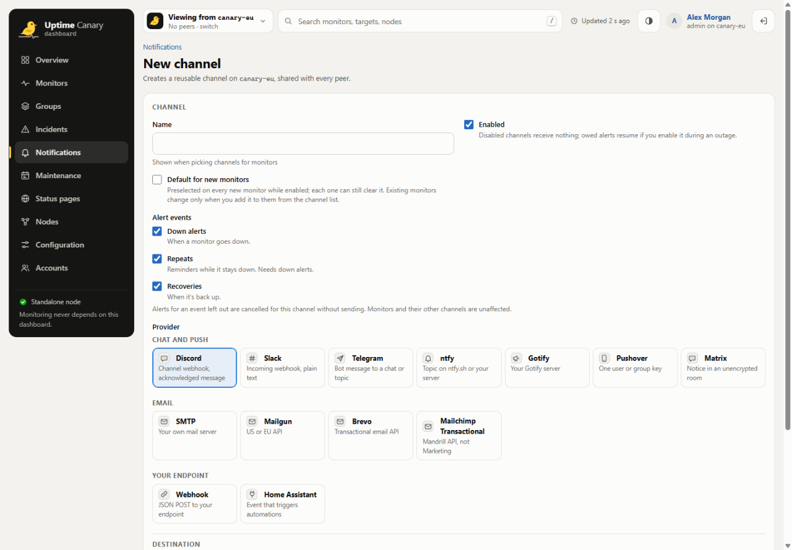
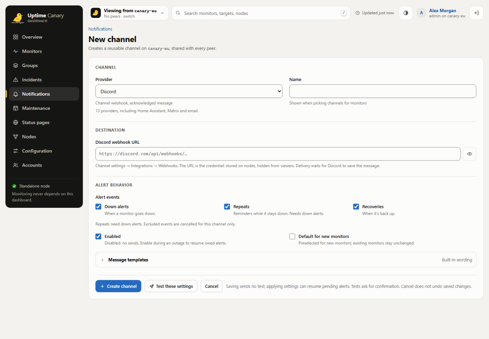
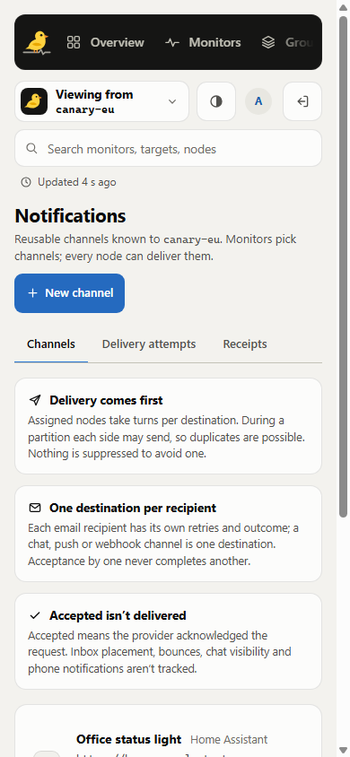
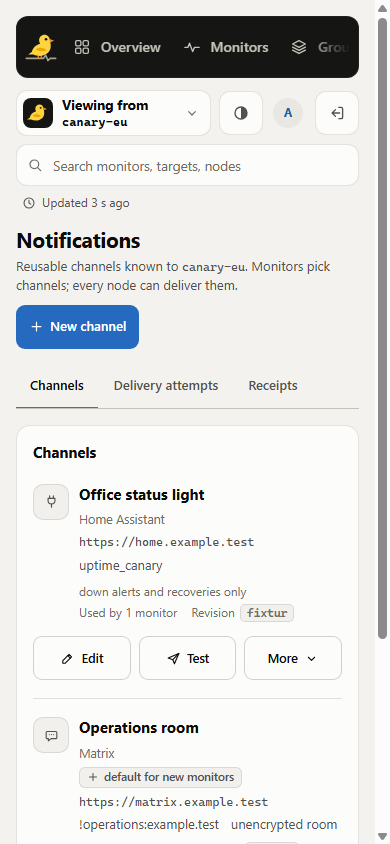
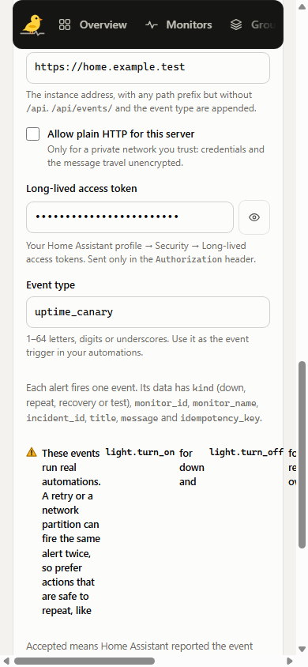
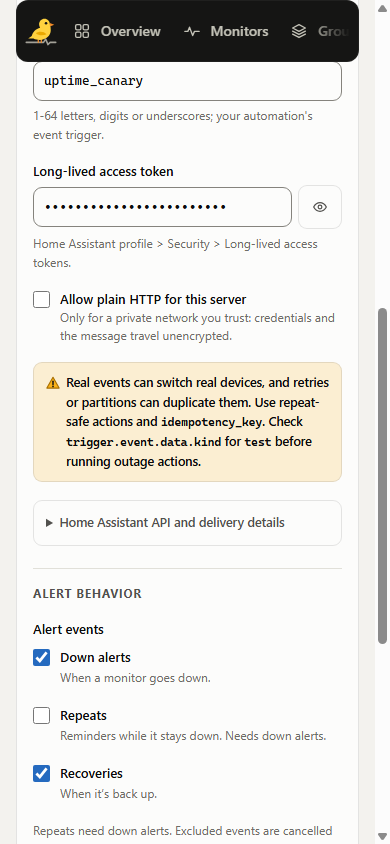

# Notification channel UI evidence

Channel management now puts destinations and primary actions first. Setup follows provider, destination, then alert behavior. Tests identify the destination before sending, and interrupted submissions lead to inspection while preserving unsaved settings.

These screenshots show the actual React/CSS with a private in-memory API and simulated data. Desktop captures use 1440 x 1000; mobile captures use 390 x 844. Credentials are masked. No Go process, application database, or external notification was used for these captures.

| Flow | Before | Current |
| --- | --- | --- |
| Create a channel, desktop |  |  |
| Manage channels, mobile |  |  |
| Home Assistant setup, mobile |  |  |

The before captures use commit `cc0e7d5bcda2e070cdc39259b00db3c37e3e8531`. Current captures use product commit `73ef734a6c4389e6d18dd68db46c57559d490b33`. The full local review set contains 59 current screens covering both themes, validation, mixed recipient outcomes, failed reads, uncertain mutations, and draft retention. Its manifest records hashes for all images and eight product source files.

Observed local checks: workspace types, 47 focused automation contracts, and 28 web-image pure suites pass. Browser measurements confirm 44px mobile segmented controls and delivery filters. Recorded interactions cover precise error targeting, retained outcomes, save readback, and the rejected-sign-in Leave/Keep/Discard flow. Segmented help associations are verified programmatically.

Hosted Linux Go/Chrome execution and the native recipient-order regression are pending at publication. These captures and component checks do not establish provider delivery, complete pointer or screen-reader coverage, or complete Go/SQLite HA release validation.
