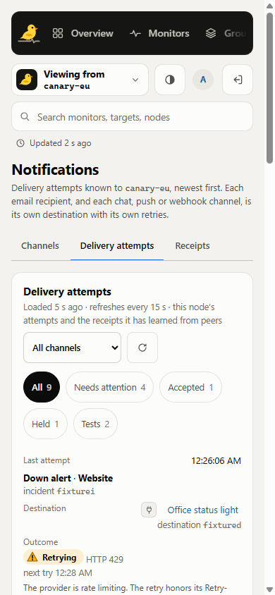
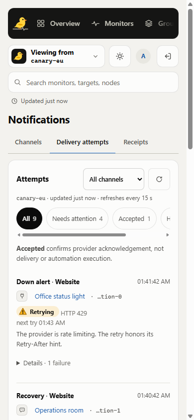
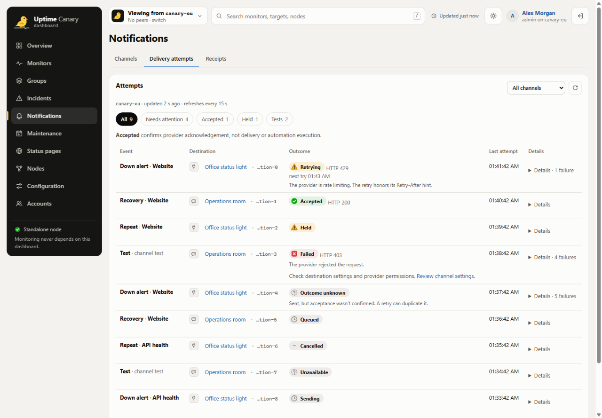
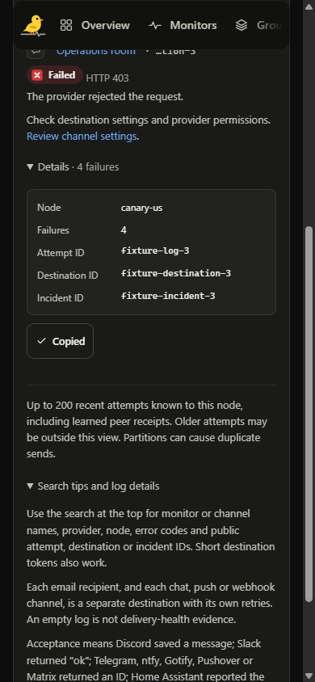

# Delivery investigation efficiency

Delivery attempts now lead with the event, destination and outcome. Retry timing,
failure explanations and uncertainty stay visible. Each row has a keyboard
operable Details disclosure for the full attempt, destination and incident IDs,
node, failure count and acknowledgement hash. Copy details copies these full
identifiers together, with success/refusal feedback. Disclosure accessible names
include their visible failure count. Ambiguous routes within a channel
get a distinct short public-ID token while collapsed; suffix collisions display
the full ID. Empty results identify their active scope and offer local Clear
search and Reset all filters actions. Failed refreshes retain the rows
and put a warning above the filters. Viewer privacy notices wrap on small screens.
Channel setup, test confirmations and draft-safe test inspection retain their
existing behavior. Known, final rejections link to the existing channel editor
with conditional settings/permissions guidance; unknown outcomes do not gain a
resend action.

## Before and after

The baseline is the merged PR #34 tree, `d0718287cee9c741af36a1a0b9dd1474d973574a`.
Both mobile captures use the same nine simulated attempts and 390 by 844 viewport.

| Before | After |
| --- | --- |
|  |  |





The nine collapsed rows occupy **2,300.91px before and 1,677.73px after**, a
**27.08% reduction in row area** at the same width. All nine states remain present;
critical explanations remain expanded. Diagnostic identifiers require one extra
disclosure action. Whole-page height falls from 3,194px to 2,417px (24.33%).
At 390 by 844, the first event starts at 557px, its Details control ends at 753px,
and the next event heading starts at 786px. The complete first attempt and the
next heading are visible without scrolling.
On narrow screens the 44px outcome choices scroll horizontally; keyboard focus
brings each choice fully into view. These are layout measurements, not measurements of human task completion time.

## Measured computation

`scripts/delivery-view-proof.mjs` compares the original filtering and chip-count
derivation with the production single-pass helper. It first checks **480 output
equivalence cases**, including original row identity/order, overlapping test
counts, channel scope, empty results and case-insensitive search. Separate cases
cover newly supported public attempt/destination IDs and displayed destination
tokens. These identifiers intentionally add matches beyond the original search.

On Windows x64, Node 24.22.1, at the real API maximum of 1,000 attempts:

| Workload | Original median | Current median | Elapsed time reduction |
| --- | ---: | ---: | ---: |
| Unfiltered log | 33.275ms | 9.367ms | **71.85%** |
| Search for `service` | 430.028ms | 436.282ms | -1.45% |
| Single channel | 9.250ms | 8.380ms | 9.41% |

Each sample performs 1,500 derivations, rotating all five filters. Both paths warm
until recent samples stabilize, with at least 12 and at most 40 warm-up pairs.
The unfiltered case stabilized after 15 pairs; the others after 12. Eleven
measured pairs alternate execution order. Medians are reported.
The unfiltered result is about **22.18 microseconds versus 6.24 microseconds per
derivation**. These are elapsed timings from `performance.now()`, not process CPU
measurements. An earlier single-warm-up run recorded a baseline tier transition
from about 78ms to 32ms; its 88.57% median reduction is superseded by this sustained
warm-up result. This exceeds the 25% target for that operation. It does not imply
an equivalent improvement in page loading, React rendering, searches, network
requests or provider delivery. Destination-token presentation and memoization gains are excluded from this
benchmark. Search now examines additional public IDs; the measured search
workload is 1.45% slower. No search-speed improvement is claimed.

Reproduce using the owned cache, with no concurrent validation:

```sh
python scripts/bounded_validation.py --timeout 120 -- node scripts/delivery-view-proof.mjs --benchmark
```

The automation integration workflow also runs this proof on Linux. Timing varies
by runtime and host; CI checks output equivalence rather than a noisy speed gate.

## Validation scope

Local type checking, 49 focused contract groups and the 480 equivalence cases
pass. Browser checks cover light/dark desktop and mobile, 320px hash wrapping,
search/channel/problem filters, keyboard disclosure toggling, open-detail
retention during reload, failed-refresh retention, viewer read refusal and
mounted-editor inspection after an unconfirmed test. Current captures use the
real frontend with private in-memory API responses; no Go process, database or
provider sends were involved. Hosted workflow results apply only to their tested
commit; the PR records that execution separately.
Copy success/refusal checks use controlled browser clipboard promises without
accessing the workstation clipboard. Pointer and screen-reader coverage is
incomplete. These component checks do not establish complete Go/SQLite HA release
readiness.

## Independent UI assessment

The final read-only Sol assessment scored the notification experience **9.50/10**,
using five equally weighted criteria: task clarity 9.5, investigation/correction
effort 9.5, honest recovery/privacy 9.6, responsive/accessibility foundations 9.5,
and visual coherence 9.4. Source verdict: approved, with no actionable findings.
Benchmark speed did not contribute to this UI score. The assessment covers the
scoped source and supplied screenshots, not complete accessibility or release
validation.
